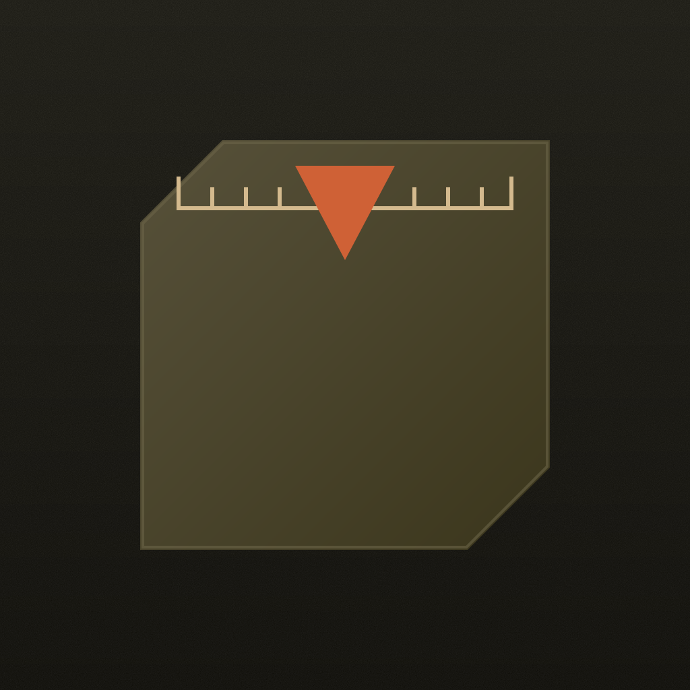
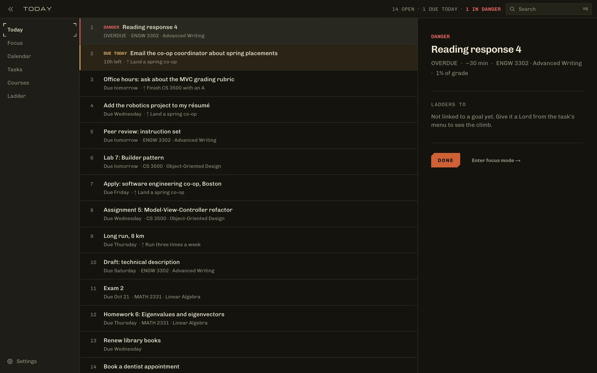
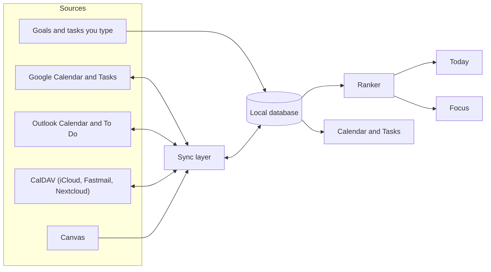
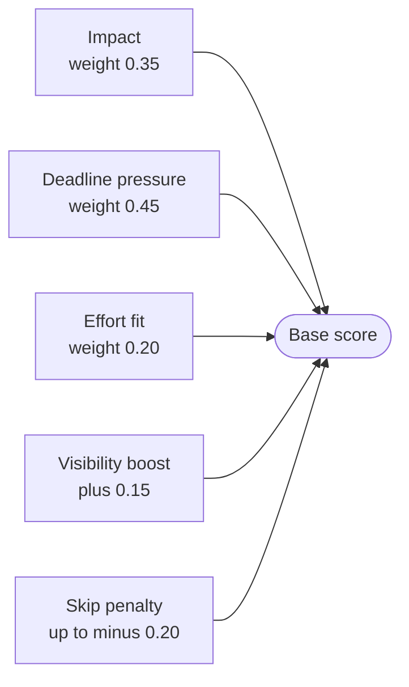
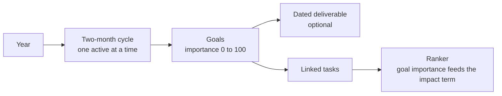
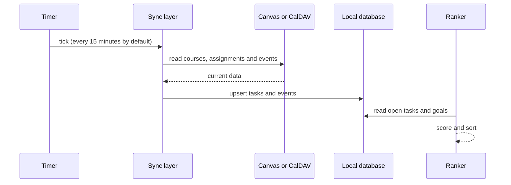
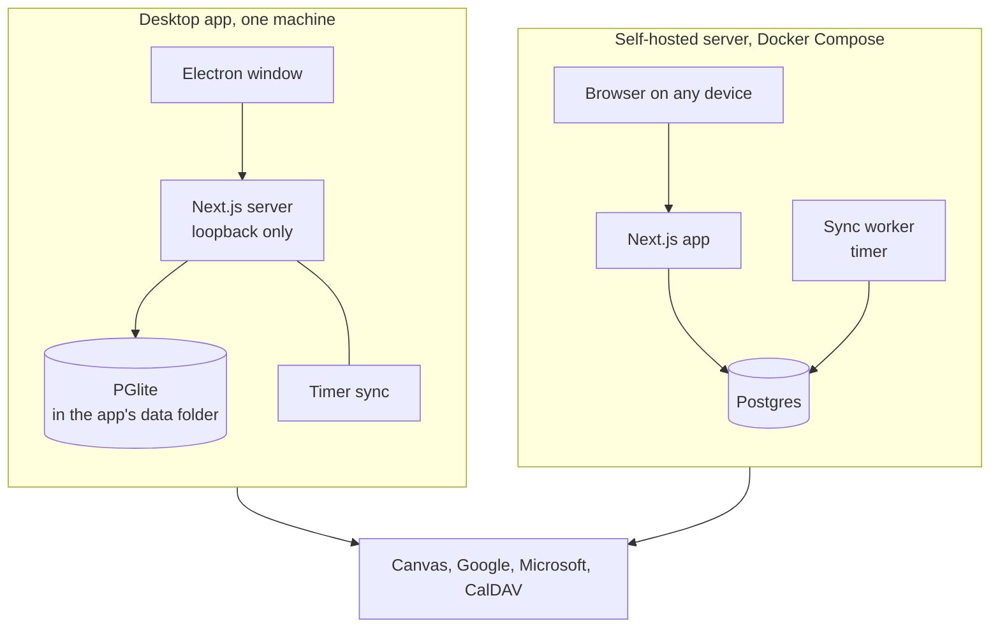

<p align="center"></p>

<h1 align="center">Erwin</h1>

<p align="center">
Erwin reads your calendar, your Canvas courses and your goals, ranks everything you have
to do with a score you can read, and shows you the one thing to start next.
</p>

<p align="center">
  <a href="https://kaitosoeno.com/erwin">kaitosoeno.com/erwin</a> ·
  <a href="#install">Install</a> ·
  <a href="#how-the-ranking-works">Ranking</a> ·
  <a href="DATAFLOW.md">Data flow</a> ·
  <a href="https://kaitosoeno.com/privacy">Privacy</a> ·
  <a href="LICENSE">MIT License</a>
</p>



## What it does

A student's week is spread across a calendar, a learning management system and a pile of personal goals, and no one of them knows how the others compare. Erwin pulls them into one local database and ranks every task on one scale, so the top row is always the one to start. It runs as a desktop app with its own database, which means a download works offline with no account, or as a server you host to reach the same data from every device.

- **It ranks by what is at stake.** Due dates, Canvas grade weights and goal importance feed one fixed-weight score (`src/lib/erwin/rank-stage1.ts`), so the order never changes for a reason you cannot read.
- **It shows one thing at a time.** Focus mode puts the next task, its course materials and its deadline on one screen, with done, skip and later on the D, S and L keys.
- **It holds your week.** Google, Outlook and CalDAV calendars sit beside your classes, and tasks drag into the open time or schedule themselves.
- **It mirrors your courses.** Canvas assignments arrive with their grade weights, your grades and feedback land in a gradebook, announcements and Inbox messages are kept, and course pages and files are stored locally so a task's materials open from the task.
- **It tells you what changed.** Every sync records what's new in Canvas (an announcement, a file, a moved due date, a posted grade, work gone missing) in one Activity feed, with an unseen count in the top bar on every page.
- **It plans in two-month cycles.** Goals belong to a cycle with a dated deliverable, and tasks linked to a goal rank higher.

## How it fits together

Every source is read into the local database first, and the ranker and every screen read only from that database. This means Today and Focus keep working when a service is slow or offline, and the only code that talks to the outside is the sync layer.



Canvas is read-only, and Google, Outlook and CalDAV sync in both directions, so an event you move in Erwin moves in the calendar it came from. Canvas and CalDAV also sync in the background on a timer (every 15 minutes by default), while Google and Outlook sync when you use them in the app.

## How the ranking works

Erwin's ranker is deterministic arithmetic, with no model and no learned weights, so you can work out why a task is on top. Each open task gets a base score between 0 and 2, built from three weighted terms plus a boost and a penalty.



| Input | How it is computed |
|---|---|
| **Impact (0.35)** | The larger of the task's grade impact and its goal importance (0 to 100, divided by 100), then divided by the largest value in the current pool so grade-driven and goal-driven tasks compete on one 0 to 1 scale. Grade impact comes from the assignment's points and its group's weight in Canvas, and it falls by 10% for each day a task is late (to a floor of 0.05, and to half after the lock date). |
| **Deadline pressure (0.45)** | A sigmoid of the hours left, `1 / (1 + e^(0.15 × (hours - 48)))`, which is 0.5 at 48 hours out, rises toward 1 as the due date nears, and stays at 1 once a task is overdue. A task with no due date scores 0. |
| **Effort fit (0.20)** | How well the task's estimate (30 minutes when none is set) matches the open slot (240 minutes when no slot is known), as `1 - abs(estimate - slot) / max(estimate, slot)`. |
| **Visibility boost (+0.15)** | Added to a Canvas task due in more than 7 days whose points sit above the 80th percentile of that course's open work, so a large far-off assignment is not invisible until it is urgent. |
| **Skip penalty (up to -0.20)** | 0.05 for each time you skipped the task (capped at 0.20), halving every 48 hours since the last skip, so repeated avoidance costs a task its lead and one skip is forgotten by the weekend. |

The score alone does not set the order. Tasks are sorted by the keys below in turn, so the base score orders only the tasks that match on every earlier key, and the due date and then the title break exact ties.


A task is in danger when it is overdue, when less than three times its estimated effort remains before the due date, or when it has been skipped three times, has a grade impact above 0.5 and is due within five days. A personal task is any non-Canvas task that is not marked high priority and is not linked to a goal, so goal-linked tasks always compete in the main pool.

## The two-month goal cycle

The year is six fixed two-month blocks (January and February, March and April, and so on), and the current block always exists. A goal belongs to a cycle, carries an importance from 0 to 100 and a definition of done, and can be marked as the cycle's dated deliverable.



Linking a task to a goal gives it an impact signal beside its grade impact, which is why a personal goal can outrank coursework once the coursework is far enough from its deadline.

The Ladder page reads a cycle as a character sheet. A goal names the stats its work develops, from a fixed set of eight (Vigor, Mind, Endurance, Strength, Dexterity, Intelligence, Faith and Arcane). Every finished task earns 1 XP, split evenly across its goals and then across their stats, and a felled deliverable earns 5. Level L costs L(L+1)/2 XP in all, so each level asks for one more XP than the last. The XP is worked out from finished tasks each time the page loads and is never stored, so changing a goal's stats changes its history too (`src/lib/erwin/xp.ts`). Each cycle can name a Build, the two or three stats it pushes, and the page shows how much of the cycle's XP landed on them. A new cycle starts with the Build of the one before. A tool that keeps your goals somewhere else can send the Build along with them (`POST /api/erwin/goals/project`), and the page then shows it read-only. `GET /api/erwin/xp` gives the same XP over any span of days.

A goal gets its work in two ways: it can claim where the work comes from (all of Canvas, one course, or a project), and every task from there files under it on its own, finished ones included; or you link tasks to it from Tasks. A boss is a dated milestone on a goal, and it can name its proof: a Canvas gradebook item or another task. The proof settles it. Handing the work in, a grade or an excusal fells the boss, the item's due date replaces the boss's, and an in-class exam with nothing to hand in falls when its grade is posted. A boss with no proof is marked done by hand. A goal you set aside files nothing new but keeps the XP its finished work earned (`src/lib/erwin/goal-rules.ts`, `src/lib/erwin/boss-proof.ts`).

## A sync, step by step



## Install

Erwin has not had its first release yet. The channels below are set up in `packaging/` and go live with it, and until then you can run it from source.

| System | Channel | How |
|---|---|---|
| macOS | Mac App Store | Link at release |
| macOS | Homebrew | `brew install --cask pockanoodles/tap/erwin` |
| macOS | Disk image (Apple silicon, Intel) | [GitHub Releases](https://github.com/pockanoodles/erwin/releases) |
| Windows | Microsoft Store | Link at release |
| Windows | winget | `winget install KaitoSoeno.Erwin` |
| Windows | Installer (.exe) | [GitHub Releases](https://github.com/pockanoodles/erwin/releases) |
| Linux | Snap Store | `sudo snap install erwin` |
| Linux | AUR | `yay -S erwin-bin` |
| Linux | AppImage, .deb, .rpm | [GitHub Releases](https://github.com/pockanoodles/erwin/releases) |
| Server | Docker Compose | See [Self-host](#self-host) |

Store builds update through their store, Linux packages through their package manager, and the direct downloads update themselves.

## Run from source

You need Node 20. Nothing else has to be installed.

```bash
git clone https://github.com/pockanoodles/erwin && cd erwin
npm install
npm run dev:local -- --seed demo
```

`dev:local` runs Erwin on PGlite (Postgres compiled to WebAssembly) with no Postgres or Docker, keeps its database in `.local/`, and prints a link that signs you in. `--seed demo` fills a fresh database with one example week of classes, assignments and goals, and `--reset` starts over.

## Self-host

To use Erwin from several devices, run the server with Postgres.

```bash
cp .env.example .env    # then set NEXTAUTH_SECRET, ERWIN_SECRET_KEY and POSTGRES_PASSWORD
docker compose up -d
```

Generate the two secrets with `openssl rand -base64 32` and the database password with `openssl rand -hex 24`, then put the same password in `DATABASE_URL`. Open http://localhost:3000, and the first account you create is the admin. `ERWIN_SECRET_KEY` encrypts stored credentials (OAuth tokens, the Canvas token, CalDAV passwords), so keep it with your backups, because losing it means connecting every integration again.

Compose refuses to start without `POSTGRES_PASSWORD`, and there is no default. It publishes Postgres on 127.0.0.1 only, so other machines cannot reach it. The user and database name (`erwin` by default) apply only when the database volume is first created, so changing them later means a new volume.

Password reset email needs `RESEND_API_KEY` and `EMAIL_FROM`, an address on a domain you have verified in Resend. Without `EMAIL_FROM` the server logs an error and sends nothing. The desktop app sends no email.

Background sync runs on a timer in the `worker` service, every 15 minutes by default. A single container can set `ERWIN_SCHEDULER=inprocess` instead, which runs the same loop inside the app. Run one or the other, not both.

## Deployment modes

The desktop app and the self-hosted server run the same Next.js code, and they differ in where the database lives and who can reach it.



Pick the desktop app if you want a download that works offline with no account. Pick the server if you want the same data on a phone and a laptop, or if you want Google and Outlook sign-in today.

## Connecting services

**Canvas.** In Settings, open Task Sync and add your Canvas URL with a personal access token (in Canvas, Account, then Settings, then New access token). Erwin keeps only current courses, judged by the term in the course name or an upcoming due date. The token is stored encrypted and is only ever used to read. An OAuth connection is planned for distributed builds, so that the app can connect without a token you paste in.

**CalDAV** (iCloud, Fastmail, Nextcloud). In Settings, open Accounts, choose Connect CalDAV Calendar, and enter the server URL with an app-specific password.

**Google Calendar** needs your own OAuth app.

1. In the [Google Cloud Console](https://console.cloud.google.com), create a project and enable the Google Calendar API and the Google Tasks API.
2. Configure the OAuth consent screen as External, add the scopes `calendar`, `calendar.events`, `userinfo.email` and `openid` (and `tasks` for Google Tasks), and add yourself as a test user.
3. Create an OAuth client ID of type Web application, with `http://localhost:3000` as an origin and `http://localhost:3000/api/calendar/google` as a redirect URI (and the same pair for your own domain).
4. Enter the client ID and secret in Settings, under System, or set `GOOGLE_CLIENT_ID` and `GOOGLE_CLIENT_SECRET`.

**Outlook** needs an Azure app registration.

1. In the [Azure portal](https://portal.azure.com/#blade/Microsoft_AAD_RegisteredApps/ApplicationsListBlade), register a multitenant app that also allows personal Microsoft accounts.
2. Add a Web platform with the redirect URI `http://localhost:3000/api/auth/callback/azure-ad` (and your own domain's), and enable access and ID tokens.
3. Add the delegated Microsoft Graph permissions `Calendars.ReadWrite`, `Tasks.ReadWrite`, `User.Read` and `offline_access`.
4. Create a client secret and enter the client ID, secret and tenant in Settings, under System.

In the desktop app, Canvas and CalDAV connect today. Google and Outlook sign-in open in your browser, and finishing them inside the desktop app is the next piece of work, so connect those two from a self-hosted server for now.

## How the desktop app works

The desktop app is Electron around the same Next.js server. On launch it opens a PGlite database in the app's data folder, applies the migrations, saves a copy of the database before any migration that changes it, and serves it over the Postgres wire protocol, so the app's Prisma client uses it exactly as it uses Postgres on a server. The server listens on the loopback interface only, signs the one local user in with a token that changes every launch, and runs background sync on a timer. [`DATAFLOW.md`](DATAFLOW.md) lists what leaves your machine and why.

## Development

| Command | What it does |
|---|---|
| `npm run dev:local` | The app on PGlite, nothing else needed |
| `npm run dev` | The app against your own Postgres (`DATABASE_URL`) |
| `npm run test:unit` | Jest |
| `npm run type-check` / `npm run lint` | TypeScript and ESLint |
| `npm run build:desktop` | Builds the server for the desktop app into `desktop/.stage` |
| `npm run desktop:start` | Runs the desktop shell against that build (after `npm --prefix desktop install`) |
| `node scripts/brand-assets.mjs` | Regenerates every icon from `brand/` |

The repository holds the app (`src/`, `prisma/`), the desktop shell (`desktop/`), the landing page (`site/`), the brand (`brand/`, see `brand/BRAND.md`), and the release setup (`packaging/`, whose README is the release runbook).

## Privacy

Your tasks, notes, goals and course materials stay in the database on your machine or your server. Erwin has no analytics, no crash reporting and no telemetry, and it sends nothing to any AI service. It contacts only the services you connect (Canvas, Google, Microsoft, a CalDAV server) and, for desktop builds downloaded from GitHub, GitHub Releases to check for an update. Credentials are stored encrypted with `ERWIN_SECRET_KEY`. [`DATAFLOW.md`](DATAFLOW.md) lists every endpoint, what is sent and why, and the privacy policy is at [kaitosoeno.com/privacy](https://kaitosoeno.com/privacy).

## Credits

Erwin began as a fork of [FluidCalendar](https://github.com/dotnetfactory/fluid-calendar) by Emad Ibrahim, an open-source alternative to Motion, and keeps its MIT license. Erwin is not affiliated with or endorsed by FluidCalendar or its author.

## License

MIT. The license carries two copyright lines, Copyright (c) 2024 Emad Ibrahim and Copyright (c) 2026 Kaito Soeno. See [LICENSE](LICENSE).

## Name

Erwin is unrelated to erwin Data Modeler (Quest Software) and to any fictional character.
