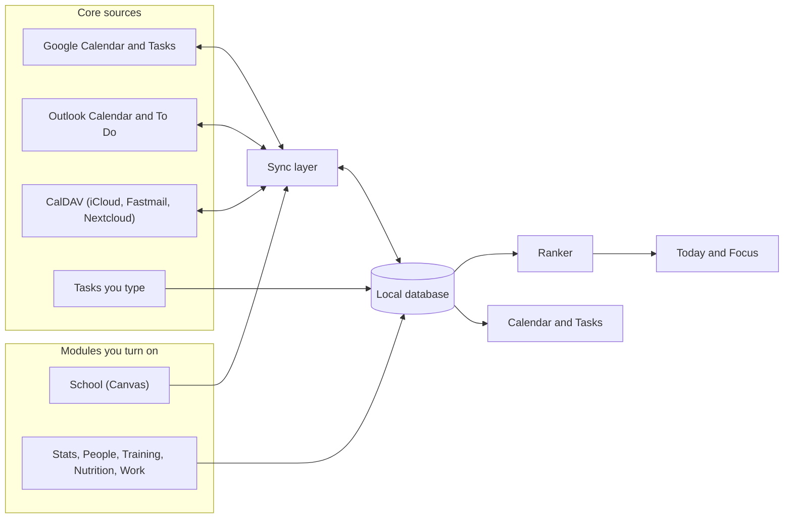
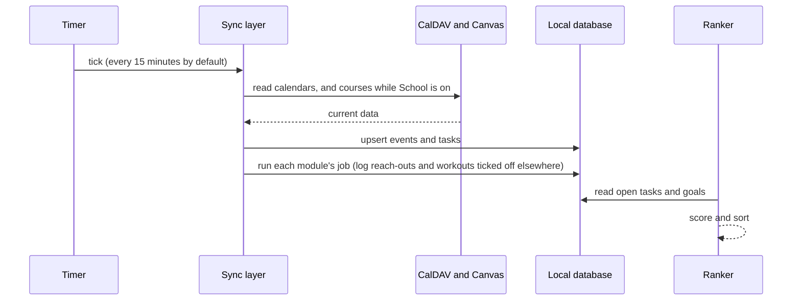
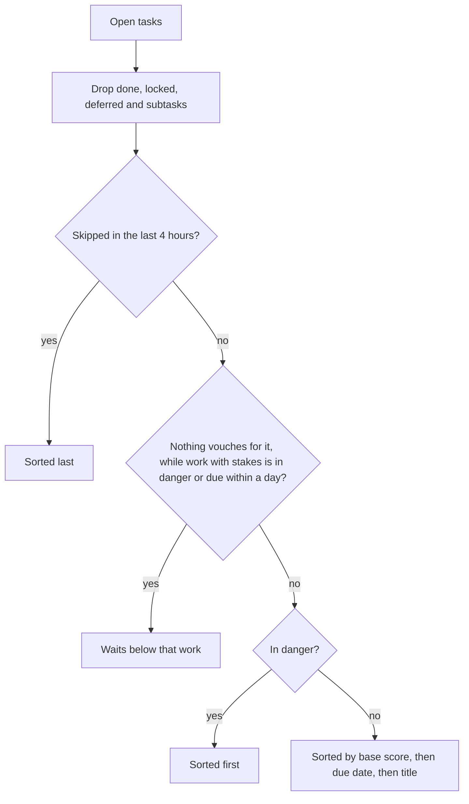
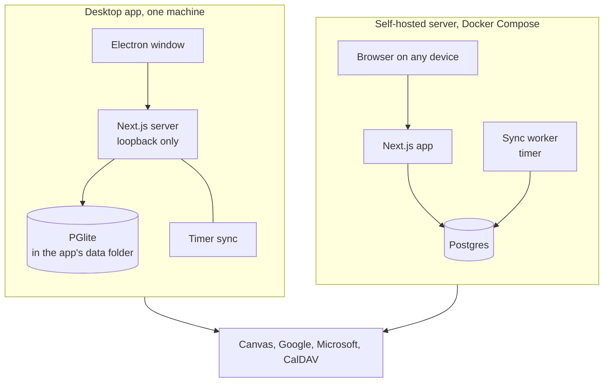

<p align="center"></p>

<h1 align="center">Erwin</h1>

<p align="center">
Erwin reads your calendar and your tasks, ranks everything you have to do with a score you
can read, and shows you the one thing to start next. Modules add the rest when you turn them
on, from your Canvas courses and goals to your workouts and meals.
</p>

<p align="center">
  <a href="https://kaitosoeno.com/erwin">kaitosoeno.com/erwin</a> ·
  <a href="#install">Install</a> ·
  <a href="#modules">Modules</a> ·
  <a href="#how-the-ranking-works">Ranking</a> ·
  <a href="DATAFLOW.md">Data flow</a> ·
  <a href="https://kaitosoeno.com/privacy">Privacy</a> ·
  <a href="LICENSE">MIT License</a>
</p>


## What Erwin does

Your week is spread across calendars, task lists and whatever else you keep track of, and none of them knows how the others compare. Erwin pulls them into one local database and ranks every task on one scale, so the top row is always the one to start. It runs as a desktop app with its own database, which means a download works offline with no account, or as a server you host to reach the same data from every device.

- **It ranks by what is at stake.** Due dates, what each task is worth and how much its goal matters feed one fixed-weight score (`src/lib/erwin/rank-stage1.ts`). The order never changes for a reason you cannot read.
- **It shows one thing at a time.** Focus puts the next task, what you need for it and its deadline on one screen, with done, skip and later on the D, S and L keys.
- **It holds your week.** Google, Outlook and CalDAV calendars sit together in one view, and tasks drag into the open time or schedule themselves.
- **It holds only what you use.** [Modules](#modules) add your Canvas courses, goals in two-month cycles, the people you keep in touch with, your workouts, what you eat and the shifts you work. Turning one off hides it everywhere and deletes nothing.
- **It keeps your data with you.** Everything sits in a database on your machine or your server, and Erwin has no analytics and no AI service ([Privacy](#privacy)).

## The core

Every Erwin has the same four pages, and they hold their place at the top of the rail while modules come and go below them.

| Page | What it is for |
|---|---|
| **Today** | Every open task in ranked order. The panel beside it shows the selected task's deadline and goal, and Done finishes it in one click. |
| **Focus** | The top task alone on the screen with what you need for it, its deadline and how long it should take. Done, skip and later move you to the next one. |
| **Calendar** | Day, week, month and year views of every calendar you connect. Tasks drag into open time, or Auto Schedule places them around your events. |
| **Tasks** | Everything you have to do as a list, a board or a spreadsheet-style sheet. The bar above the sheet shows the selected cell in full and edits it there. |

The top bar is the same strip on every page. It holds the page's own views and actions, a count of what is open, due today and in danger, and a search field that opens the command palette (⌘K). On a phone, a page's views fold into one menu and its actions show as icons, so the bar stays one line.

## Modules

The core works on its own, and everything else is a module you turn on or off at `/modules`. Each module's row there says what it adds, what it keeps and what it sends out of Erwin. Stats starts on and the others start off, except that School comes on by itself for an install that already had Canvas connected.

| Module | What it adds | Sends data to |
|---|---|---|
| **School** | Canvas assignments ranked by their share of your grade, and a School page with activity, grades, news and course materials | Your school's Canvas, read only |
| **Stats** | Goals in two-month cycles that claim their work and lift it in the ranking, XP, and a Goal column with goal tabs on Tasks | Nothing |
| **People** | The people you keep in touch with, and a reach-out task when someone is due a check-in | Nothing |
| **Training** | The workouts you repeat, each due on its schedule and logged with its sets, reps and weights | Nothing |
| **Nutrition** | What you eat against daily targets for calories, protein, carbs and fat, with the protein left today in the top bar | Nothing |
| **Work** | The jobs you work shifts at: every shift on the calendar, hours against a weekly cap, pay so far, the people to call, and a task to submit your hours each pay period | Nothing |

Turning a module off hides its page and its tasks from every list and from the scheduler, stops its background work and keeps everything it stored. Its API answers 409 `module_off` while it is off, so a script that calls it fails loudly instead of writing into a module no one can see.

### School

School mirrors your Canvas courses. Erwin reads your current courses every 15 minutes and turns their assignments into tasks. Your scores, feedback and rubrics land under Grades, announcements and Inbox messages under News, and module pages and files under Library, stored locally so a task's materials open from the task. Canvas is only ever read, and nothing is written back.

An assignment's impact in the ranking is its share of your final course grade. A weighted course splits each group's weight across the group's points, an unweighted course divides an assignment's points by the course total, and work that doesn't count toward the grade gets none. The Activity view lists what changed since you last looked (an announcement, a new file, a moved due date, a posted grade, work gone missing), with an unseen count in the top bar on every page. In Focus and in the task sheet's pane, an assignment shows its instructions, rubric and materials.

### Stats

Stats holds your goals. The year is six fixed two-month cycles, which the page calls hexes (January and February, March and April, and so on), and the current one always exists. A goal belongs to a cycle and carries an importance from 0 to 100 and a definition of done, and a goal's importance lifts the tasks that serve it in the ranking. That lift is why a personal goal can outrank coursework once the coursework is far enough from its deadline.

A goal gets its work in two ways. It can claim where the work comes from, and every task from there files under it on its own, finished ones included. A claim can cover all of Canvas, one course, your Google or Outlook tasks, all reach-outs, all workouts, one Training routine or a project. You can also link a task to a goal by hand in the Goal column on the Tasks page, where each of the cycle's top goals gets a tab along the bottom.

A boss is a dated milestone on a goal, and it can name its proof, which is a Canvas gradebook item or another task. Handing the work in, a grade or an excusal fells the boss, and the item's due date replaces the boss's. A boss with no proof is marked done by hand. A goal you set aside files nothing new but keeps the XP its finished work earned (`src/lib/erwin/goal-rules.ts`, `src/lib/erwin/boss-proof.ts`).

The Stats page reads a cycle as a character sheet. A goal names the stats its work develops, from a fixed set of eight (Vigor, Mind, Endurance, Strength, Dexterity, Intelligence, Faith and Arcane). Every finished task earns 1 XP, split evenly across its goals and then across their stats, and a felled boss earns 5. Level L costs L(L+1)/2 XP in all, so each level asks for one more XP than the last. XP is worked out from finished tasks each time the page loads and is never stored, so changing a goal's stats changes its history too (`src/lib/erwin/xp.ts`). Each cycle can name a Build, the two or three stats it pushes, and the page shows how much of the cycle's XP landed on them. A tool that keeps your goals somewhere else can send them, with the Build, through `POST /api/erwin/goals/project`, and `GET /api/erwin/xp` reports the same XP over any span of days.

### People

People keeps the people you want to stay in touch with. Give someone a cadence (every week up to every six months), and a "Reach out to" task appears a few days before they're due. Logging a conversation on the People page (a message, call, meeting or email) finishes that task and plans the next one from it. Ticking the task off anywhere else in Erwin logs a conversation too, so the next check-in is planned either way.

### Training

Training holds the workouts you repeat. A routine has a name, a schedule and how many minutes a session takes, and it plans its exercises as sets × reps. The schedule can be every day, every 2 or 3 days, 2 or 3 times a week, every week or every 2 weeks. When a session is due, a task named for the routine shows up in Today, due by the end of that day in your time zone.

You log a session on the Training page, one line per exercise as sets × reps @ weight, in kilograms or pounds. The form starts from what you lifted last time, taking each planned exercise from the latest session that did it, so most days you only press Log it. Logging finishes the task and plans the next session. If you tick the workout off from Today or Focus instead, it still counts as a session, and the Training page asks you to fill in its weights after. History lists every session, any of which can be changed or deleted, and Focus shows a workout's exercises with last time's numbers.

### Nutrition

Nutrition tracks what you eat against daily targets for calories, protein, carbs and fat, and any target can be left untracked. The Day view shows each target as a meter above the day's entries, and you can step back through earlier days. A saved food is logged in one click, and a new food can be saved as you log it. Each entry keeps its own copy of the amounts, so changing a saved food later leaves what you already ate as it was. The top bar shows the protein left today on every page (or the calories when protein has no target). Nutrition creates no tasks.

### Work

Work holds the jobs you work shifts at. Each job's shifts show on the calendar through a feed of their own, so the scheduler never plans work on top of them, and the top bar shows the next shift on every page. Shifts come in two ways. A script can send a job's schedule a week at a time (`PUT /api/erwin/shifts`), and each new week replaces that week's imported shifts while keeping what you noted on them. You can also add a shift by hand, like one you picked up, and an import never deletes it. When the schedule later lists the same shift, the two become one.

A shift that's over counts as worked. You can drop one you gave away, or enter the times you really worked when you stayed late. Give a job its hourly rate and pay period (weekly or every 2 weeks) and the Hours view adds up each period's hours and estimated pay. Once a period's shifts are worked, a task named for the hours shows up on its last day, listing every shift to enter on the timesheet. Marking the period submitted finishes the task, and ticking the task off anywhere else marks the period submitted. A weekly cap warns you when the week's shifts go over it. Each job also keeps its links (the timesheet, a handbook) and its contacts, and a shift's supervisor links to their phone number when the contacts list has them. A roster can be imported too (`PUT /api/erwin/work/import/contacts`). Contacts stay in Erwin.

### Writing a module

A module reaches the core only through the registries in `src/modules/` (the manifests, the browser's slots and the server's hooks). The boundary test (`src/modules/__tests__/boundary.test.ts`) fails on any import that goes around them. [docs/specs/modules.md](docs/specs/modules.md) describes every slot and hook and walks through adding a module.

## How it fits together

Every source is read into the local database first, and the ranker and every screen read only from that database. This means Today and Focus keep working when a service is slow or offline, and the only code that talks to the outside is the sync layer.



Google, Outlook and CalDAV sync in both directions, so an event you move in Erwin moves in the calendar it came from, and Canvas is read only. Google and Outlook sync when you use them in the app. Everything else syncs on a background timer, every 15 minutes by default.



## How the ranking works

Erwin's ranker is deterministic arithmetic, with no model and no learned weights, so you can work out why a task is on top. Each open task gets a base score between 0 and 2, built from three weighted terms plus a boost and a penalty.


| Input | How it is computed |
|---|---|
| **Impact (0.35)** | The larger of the task's own impact and the importance of the goal it serves (0 to 100, divided by 100), then divided by the largest value in the current pool so coursework and goal-driven tasks compete on one 0 to 1 scale. A task's own impact comes from the module that owns it, and today only School sets one (an assignment's share of the final grade). It falls by 10% for each day a task is late (to a floor of 0.05, and to half after the lock date). |
| **Deadline pressure (0.45)** | A sigmoid of the hours left, `1 / (1 + e^(0.15 × (hours - 48)))`, which is 0.5 at 48 hours out, rises toward 1 as the due date nears, and stays at 1 once a task is overdue. A task with no due date scores 0. |
| **Effort fit (0.20)** | How well the task's estimate (30 minutes when none is set) matches the open slot (240 minutes when no slot is known), as `1 - abs(estimate - slot) / max(estimate, slot)`. |
| **Visibility boost (+0.15)** | Added to a task due in more than 7 days whose stakes sit above the 80th percentile of its group's open work, so a large far-off assignment is not invisible until it is urgent. For Canvas the stakes are an assignment's share of the grade and the group is its course. |
| **Skip penalty (up to -0.20)** | 0.05 for each time you skipped the task (capped at 0.20), halving every 48 hours since the last skip, so repeated avoidance costs a task its lead and one skip is forgotten by the weekend. |

The score alone does not set the order. Tasks are sorted by the keys below in turn, so the base score orders only the tasks that match on every earlier key, and the due date and then the title break exact ties.



A task is in danger when it is overdue, when less than three times its estimated effort remains before the due date, or when it has been skipped three times, has an impact above 0.5 and is due within five days. A task nothing vouches for has no impact from its module, no goal behind it and no high priority, and it waits while work with stakes is in danger or due within a day. A task linked to a goal always competes in the main pool, which is how a workout or a reach-out that serves a goal holds its place. The ranker itself names no module, since impact, a goal's lift and a task's stakes all reach it from the modules that are on.

A due date picked without a time counts until the end of that day in your time zone (`src/lib/erwin/due.ts`), so a task due Wednesday is not overdue on Tuesday evening. A module's task carries a real deadline, such as a Canvas assignment's 11:59 PM, and a reach-out or a workout is due by the end of its day.

## Install

Erwin has not had its first release yet. The channels below are set up in `packaging/` and go live with it, and until then you can run it from source.

| System | Channel | How |
|---|---|---|
| macOS | Homebrew | `brew install --cask pockanoodles/tap/erwin` |
| macOS | Disk image (Apple silicon, Intel) | [GitHub Releases](https://github.com/pockanoodles/erwin/releases) |
| Windows | winget | `winget install KaitoSoeno.Erwin` |
| Windows | Installer (.exe) | [GitHub Releases](https://github.com/pockanoodles/erwin/releases) |
| Linux | Snap Store | `sudo snap install erwin` |
| Linux | AUR | `yay -S erwin-bin` |
| Linux | AppImage, .deb, .rpm | [GitHub Releases](https://github.com/pockanoodles/erwin/releases) |
| Server | Docker Compose | See [Self-host](#self-host) |
| Phone | The web app from your server or your Mac | See [On a phone](#on-a-phone) |

The Mac App Store and the Microsoft Store come later, if people ask for them.

Homebrew, winget, the Snap Store and the AUR update Erwin through `brew upgrade`, `winget upgrade`, snapd and `yay -Syu`. The Windows installer and the AppImage update themselves.

The builds are not signed by Apple or Microsoft yet. Homebrew takes care of macOS for you. If you download the disk image instead, macOS refuses to open the app until you clear the quarantine flag once: `xattr -dr com.apple.quarantine /Applications/Erwin.app`. That copy doesn't update itself, so download the next release when it comes out. On Windows, SmartScreen asks once before the installer runs (More info, then Run anyway).

Every release file is listed in `SHA256SUMS.txt` and carries a signed record of the workflow run that built it, which you can check with the GitHub CLI: `gh attestation verify Erwin-1.0.0-mac-arm64.dmg -R pockanoodles/erwin`. The server image has one too (`oci://ghcr.io/pockanoodles/erwin:1.0.0`).

## Run from source

You need Node 20. Nothing else has to be installed.

```bash
git clone https://github.com/pockanoodles/erwin && cd erwin
npm install
npm run dev:local -- --seed demo
```

`dev:local` runs Erwin on PGlite (Postgres compiled to WebAssembly) with no Postgres or Docker. It keeps its database in the `.local` folder and prints a link that signs you in. The `--seed demo` flag fills a fresh database with one example student's week, with classes, assignments, goals, three workout routines, three days of meals and a campus job's shifts, and it turns on School, Training, Nutrition and Work. The `--reset` flag starts over with an empty database. It listens on your machine only, and `--lan` opens it to a phone (see [On a phone](#on-a-phone)).

## Self-host

To use Erwin from several devices, run the server with Postgres.

```bash
cp .env.example .env    # then set NEXTAUTH_SECRET, ERWIN_SECRET_KEY and POSTGRES_PASSWORD
docker compose up -d
```

Generate the two secrets with `openssl rand -base64 32` and the database password with `openssl rand -hex 24`, then put the same password in `DATABASE_URL`. Open http://localhost:3000, and the first account you create is the admin. `ERWIN_SECRET_KEY` encrypts stored credentials (OAuth tokens, the Canvas token, CalDAV passwords), so keep it with your backups, because losing it means connecting every integration again.

Compose refuses to start without `POSTGRES_PASSWORD`, and there is no default. It publishes Postgres on 127.0.0.1 only, so other machines cannot reach it. The user and database name (`erwin` by default) apply only when the database volume is first created, so changing them later means a new volume.

Password reset email needs `RESEND_API_KEY` and `EMAIL_FROM`, an address on a domain you have verified in Resend. Without `EMAIL_FROM` the server logs an error and sends nothing. The desktop app sends no email.

Background sync runs on a timer in the `worker` service, every 15 minutes by default (`ERWIN_BACKGROUND_SYNC_INTERVAL_MS`). A single container can set `ERWIN_SCHEDULER=inprocess` instead, which runs the same loop inside the app. Run one or the other, because running both syncs everything twice.

## On a phone

On a phone, Erwin is the same web app with a layout for small screens and a bottom bar. Open it in the browser and add it to your home screen (in Safari, Share, then Add to Home Screen).

- **From a self-hosted server.** Put it behind HTTPS, with a reverse proxy or with `tailscale serve 3000` on the server, and set `NEXTAUTH_URL` to that address. Add the same address to your Google and Outlook redirect URIs.
- **From your Mac over Tailscale.** Run `npm run dev:local`, then `tailscale serve 3000` on the Mac. On the phone, open the printed sign-in link with `http://localhost:3000` replaced by the Mac's `https://<name>.<tailnet>.ts.net` address. The server stays on the Mac's loopback interface, and only your tailnet can reach it.
- **From your Mac on the same Wi-Fi.** Run `npm run dev:local -- --lan` and open the Phone link it prints. That puts the server on the network for anyone on it, so use it on a network you trust.

The sign-in link signs whoever opens it in as you, and a new one is made at every start. Don't share it.

## Deployment modes

The desktop app and the self-hosted server run the same Next.js code, and they differ in where the database lives and who can reach it.



Pick the desktop app if you want a download that works offline with no account. Pick the server if you want the same data on a phone and a laptop, or if you want Google and Outlook sign-in today.

## Connecting services

**Canvas** comes with the School module. Turn on School in Modules, then add your Canvas base URL (such as `https://your-school.instructure.com`) and a personal access token on its row (in Canvas, Account, then Settings, then New access token). Erwin keeps only current courses, judged by the term in the course name or an upcoming due date. The token is stored encrypted and is only ever used to read. An OAuth connection is planned for distributed builds, so that the app can connect without a token you paste in.

**CalDAV** (iCloud, Fastmail, Nextcloud). In Settings, open Accounts, choose Connect CalDAV Calendar, and enter the server URL with an app-specific password.

**Google Calendar** needs your own OAuth app.

1. In the [Google Cloud Console](https://console.cloud.google.com), create a project and enable the Google Calendar API and the Google Tasks API.
2. Configure the OAuth consent screen as External, add the scopes `calendar`, `calendar.events`, `userinfo.email` and `openid` (and `tasks` for Google Tasks), and add yourself as a test user.
3. Create an OAuth client ID of type Web application, with `http://localhost:3000` as an origin and `http://localhost:3000/api/calendar/google` as a redirect URI (and the same pair for your own domain).
4. Enter the client ID and secret in Settings, under System, or set `GOOGLE_CLIENT_ID` and `GOOGLE_CLIENT_SECRET`.

**Outlook** needs an Azure app registration.

1. In the [Azure portal](https://portal.azure.com/#blade/Microsoft_AAD_RegisteredApps/ApplicationsListBlade), register a multitenant app that also allows personal Microsoft accounts.
2. Add a Web platform with the redirect URI `http://localhost:3000/api/auth/callback/azure-ad` (and your own domain's), and enable access and ID tokens.
3. Add the delegated Microsoft Graph permissions `Calendars.ReadWrite`, `Tasks.ReadWrite`, `User.Read` and `offline_access`.
4. Create a client secret and enter the client ID, secret and tenant in Settings, under System.

In the desktop app, Canvas and CalDAV connect today. Google and Outlook sign-in open in your browser, and finishing them inside the desktop app is the next piece of work, so connect those two from a self-hosted server for now.

## How the desktop app works

The desktop app is Electron around the same Next.js server. On launch it opens a PGlite database in the app's data folder, applies the migrations, saves a copy of the database before any migration that changes it, and serves it over the Postgres wire protocol, so the app's Prisma client uses it exactly as it uses Postgres on a server. The server listens on the loopback interface only, signs the one local user in with a token that changes every launch, and runs background sync on a timer. [`DATAFLOW.md`](DATAFLOW.md) lists what leaves your machine and why.

## Development

| Command | What it does |
|---|---|
| `npm run dev:local` | The app on PGlite, nothing else needed |
| `npm run dev` | The app against your own Postgres (`DATABASE_URL`) |
| `npm run test:unit` | Jest, including the module boundary test |
| `npm run type-check` / `npm run lint` | TypeScript and ESLint |
| `npm run build` | The production build, then a check that no server code reached the browser bundle |
| `npm run build:worker` | Compiles the background sync worker into `dist/` |
| `npm run build:desktop` | Builds the server for the desktop app into `desktop/.stage` |
| `npm run desktop:start` | Runs the desktop shell against that build (after `npm --prefix desktop install`) |
| `node scripts/brand-assets.mjs` | Regenerates every icon from `brand/` |

The repository holds the app (`src/`, with each module under `src/modules/`, and `prisma/`), the desktop shell (`desktop/`), the landing page (`site/`), the brand (`brand/`, see `brand/BRAND.md`), and the release setup (`packaging/`, whose README is the release runbook). [docs/specs/modules.md](docs/specs/modules.md) is the contract a module follows, and [DATAFLOW.md](DATAFLOW.md) has to change in the same commit as anything that sends data somewhere new.

## Privacy

Your tasks, notes, goals, course materials, workouts, meals and shifts stay in the database on your machine or your server. Erwin has no analytics, no crash reporting and no telemetry, and it sends nothing to any AI service. It contacts only the services you connect (Canvas, Google, Microsoft, a CalDAV server) and, for desktop builds downloaded from GitHub, GitHub Releases to check for an update. Stats, People, Training, Nutrition and Work send nothing anywhere. Credentials are stored encrypted with `ERWIN_SECRET_KEY`. [`DATAFLOW.md`](DATAFLOW.md) lists every endpoint, what is sent and why, and the privacy policy is at [kaitosoeno.com/privacy](https://kaitosoeno.com/privacy).

## Credits

Erwin began as a fork of [FluidCalendar](https://github.com/dotnetfactory/fluid-calendar) by Emad Ibrahim, an open-source alternative to Motion, and keeps its MIT license. Erwin is not affiliated with or endorsed by FluidCalendar or its author.

## License

Erwin is MIT licensed. The license carries two copyright lines, Copyright (c) 2024 Emad Ibrahim and Copyright (c) 2026 Kaito Soeno, and its full text is in [LICENSE](LICENSE).

## Name

Erwin is unrelated to erwin Data Modeler (Quest Software) and to any fictional character.
